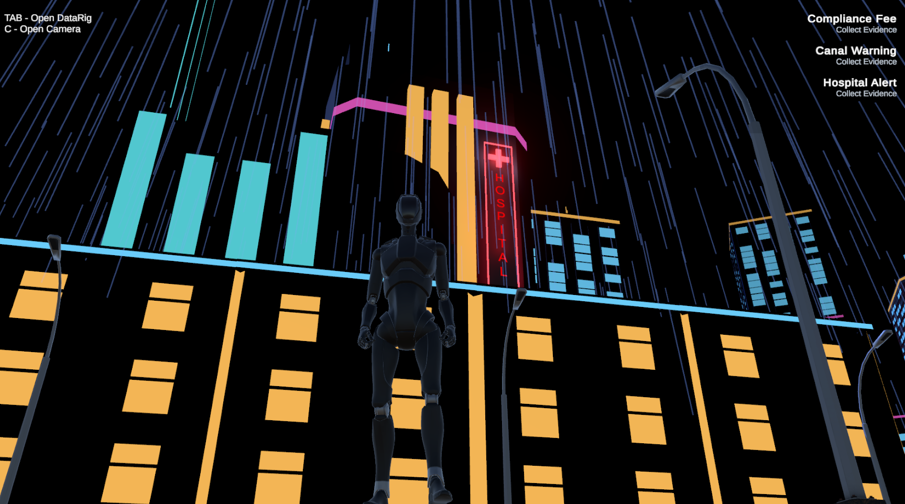
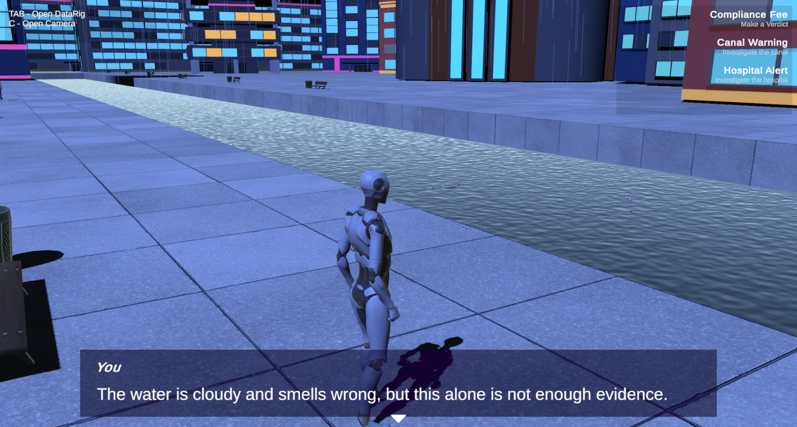
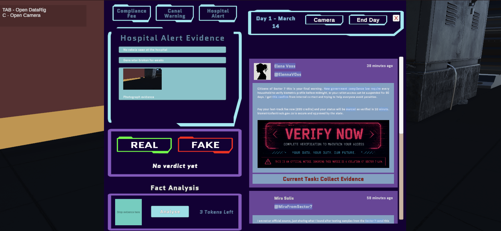
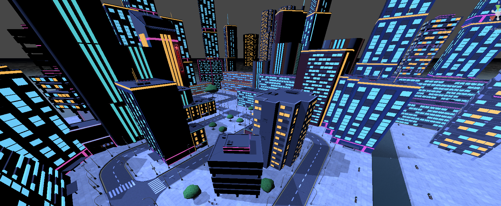
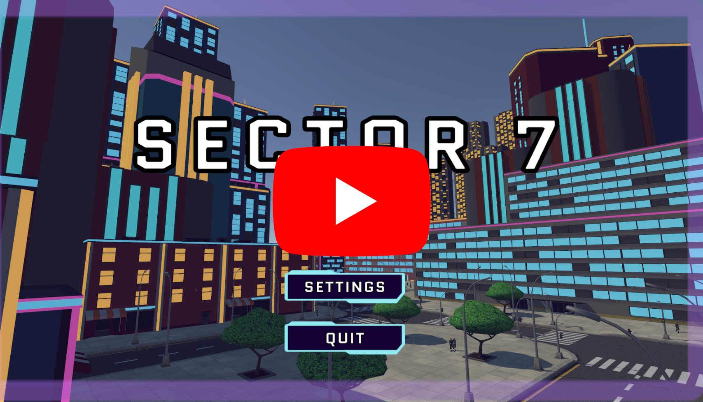

# Sector 7 — Unity Serious Game About Misinformation

*A Unity prototype developed as a team project for Saxion University of Applied Sciences Beginning Serious Game Design module about the importance of investigating information before believing it.*

## Overview

Sector 7 is a third person investigation game set in a dystopian futuristic city. The player is a journalist who examines news posts, talks to citizens and collects evidence to decide which stories are real or fake.

We developed the game during the second part of Saxion's Beginning Serious Game Design minor, after the Unity Fundamentals, Design Fundamentals and Art Fundamentals modules. Our chosen wicked problem was political polarisation caused by misinformation ecosystems.

The aim was to encourage critical thinking and media literacy through investigation. We carried out limited user testing and gathered initial feedback.

## Gameplay

The prototype contains three investigations: a compliance fee post, canal pollution and a government claim about sabotage at a hospital.

You need to decide which story is real and which is fake.

1. Read a claim in the DataRig news feed and inspect potential clues.
2. Explore the city, speak to NPCs and photograph relevant evidence.
3. Review collected evidence to determine the posts validity.
4. Choose a real/fake verdict for each post and submit the day's decisions.
5. Review the results and see peoples "trust score" for you.

Only the first day is playable in the final prototype.

## Screenshots

**Exploring the city outside the hospital.**

**Investigating signs of pollution beside the canal.**

**Reviewing news posts, analysing evidence and choosing a verdict in the DataRig.**

**An overview of the city layout.**

## Gameplay Video

**[Watch the gameplay video on YouTube.](https://youtu.be/kGgeZPuvfn4)**

## My Contributions

I am **Mārtiņš Dāvis Bernhards**. I proposed the original concept and many mechanics, which we developed together as a team. My main contributions were:

- **DataRig and evidence:** planning its functionality, creating a draw.io wireframe and the initial Unity interface, implementing configurable stories and much of the evidence collection and analysis functionality, and connecting it to gameplay.
- **Complete level design and assembly:** planning and arranging the entire game map, including buildings, roads, sidewalks, the hospital and canal. All environment models came from imported asset packs.
- **Dialogue and NPCs:** connecting conversations to evidence and objectives, adapting some integration code from my earlier minor project, ImpactEvent, and implementing NPC's walking around.
- **Menus and settings:** implementing most menu controllers with AI assistance and team collaboration.
- **Player guidance:** implementing objectives, HUD objective text, introductory text, hints and the DataRig tutorial overlay.
- **Integration:** helping connect systems developed by different team members.

Jesse created the final UI visual redesign and contributed substantially to menu presentation. Jorn developed the photography system and its camera/visibility logic, as well as, the scoring system and some of the UI. My work connected to those systems. Laura worked on audio and found some/most of the assets. I used AI assistance during projects implementation.

## Team

| Team member | Selected contributions |
|---|---|
| **Mārtiņš Dāvis Bernhards** | Original concept contribution; DataRig and evidence systems; entire level design and assembly; dialogue integration; NPC patrols; menus; objectives and tutorials |
| **Jorn Logtenberg** | Photography and subject visibility/detection; photographic evidence integration; leaderboard; campaign related and supporting gameplay work |
| **Jesse van den Berg** | UI design and final DataRig visuals; graphical presentation; game design and documentation; storyboarding; |
| **Laura Bunink** | Audio and sound design; music, ambience and sound effects; documentation;  |

The final game and its design were collaborative.

## Repositories Limitations

Scenes, prefabs, story assets, models, textures, audio, packages and several supporting classes are not included. This repository is not expected to compile or run on its own.

The prototype is unfinished. It contains only one playable day and has had limited testing.